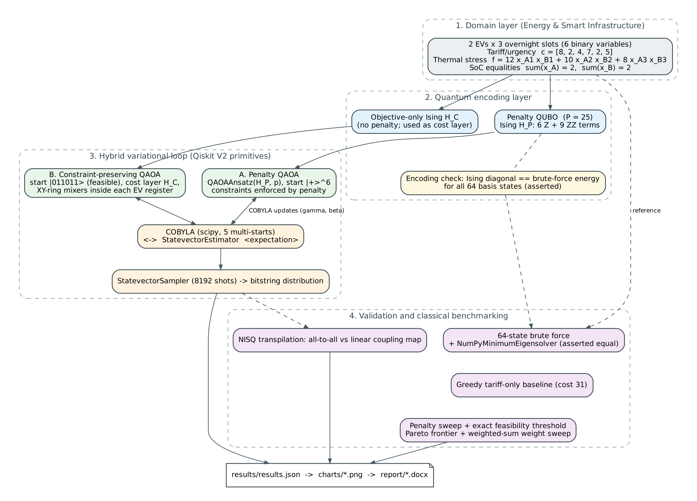

# Grid-Aware EV Fleet Charging vs. Transformer Thermal Degradation

**Qiskit Fall Fest 2026 Hackathon: The Quantum Optimization Challenge. Domain 6: Energy & Smart Infrastructure.**

Overnight charging for a two-vehicle commercial fleet, scheduled across three Time-of-Use (ToU) windows.
The objective trades off tariff/urgency cost against quadratic distribution-transformer thermal stress,
under hard state-of-charge (SoC) equalities. Two QAOA formulations are compared against exact classical references.

[](https://www.python.org/)
[](https://qiskit.org/documentation/)
[](LICENSE)

---

## 1. Problem statement

**Users:** operators of depot charging for commercial EV fleets and municipal microgrids.

**Decision:** for each EV `i` and slot `t`, `x_{i,t} ∈ {0,1}` (1 = charge in this slot).

**Objective (minimise):**

```
c^T x  +  12·x_A1·x_B1 + 10·x_A2·x_B2 + 8·x_A3·x_B3
c = [8, 2, 4, 7, 2, 5]   (ToU tariff + battery urgency per slot)
```

**Constraints (hard):** each EV charges in exactly two of its three slots.

```
x_A1 + x_A2 + x_A3 = 2        x_B1 + x_B2 + x_B3 = 2
```

**Motivation:** when two heavy-duty EVs charge in the same cheap window, transformer current rises and
I²R heating grows with the product of the two loads, which accelerates insulation ageing. The cheapest
schedule is not the best one.

**Instance size:** 6 binary variables, 64 candidate schedules, 9 feasible (14.06%).

## 2. Formulation and encoding

| Component | Expression |
|---|---|
| Penalty QUBO | objective + `P·[(Σx_A − 2)² + (Σx_B − 2)²]`, with `P = 25` |
| Ising Hamiltonian H_P | 6 single-qubit Z terms + 9 ZZ terms (no slack qubits), via `x_k = (1 − Z_k)/2` |
| Cost Hamiltonian H_C | objective alone, no penalty; used as the phase layer of the XY ansatz |

Qiskit's `QuadraticProgram` stores the coefficient of `x_i·x_j` directly. An earlier version of this
project used half the thermal coefficients in the QP. `main.py` now takes all coefficients from one table
(`THERMAL_COEFFS`), and before any quantum run it checks that the Ising diagonal equals the brute-force
energy for all 64 states. Any mismatch stops the pipeline.

## 3. Architecture



Two QAOA variants share the same problem and classical references:

- **A. Penalty QAOA:** `QAOAAnsatz(H_P, p)` starts from `|+⟩^⊗6`. Constraints are enforced by the penalty.
- **B. Constraint-preserving QAOA (XY mixer):** starts from the feasible state `|011011⟩`. Each layer applies the
  objective phase `exp(−iγH_C)`, then `XXPlusYYGate` rotations on the pairs (0,1), (1,2), (2,0) inside each EV's
  register. These gates conserve Hamming weight, so the state never leaves the 9-state feasible subspace.
  A unit test checks this numerically.

Both variants use COBYLA (5 multi-starts) on `StatevectorEstimator`, then `StatevectorSampler` (8192 shots).

## 4. Classical results (exact, reproducible without quantum hardware)

These numbers come from brute force, checked against Qiskit's `NumPyMinimumEigensolver`:

| Schedule | Bitstring (x_A1..x_B3) | Tariff | Thermal | Total |
|---|---|---|---|---|
| Naive greedy (tariff-only) | \|011011⟩ | 13.0 | 18.0 | **31.0** |
| Second-best feasible | \|011101⟩ | 18.0 | 8.0 | 26.0 |
| **Global optimum** | **\|011110⟩** | 15.0 | 10.0 | **25.0** |

- The greedy scheduler costs 6 more than the optimum, because it stacks both EVs in the cheapest slots (18 units of thermal stress).
- **Penalty feasibility threshold:** with the exact sweep (step 0.1), the penalised global minimum is feasible for
  P ≥ 12.1. At P = 1, 2, 5 and 10 it is infeasible (for example, at P = 10 the minimum is |011100⟩, which under-charges EV_B).
  The threshold is exact to the grid, and the exact sweep is in `results/results.json`.
- **Pareto frontier:** of the 9 feasible schedules, 3 are non-dominated: |011011⟩, |011110⟩, |011101⟩.
  The weighted-sum sweep recovers the optimum for tariff weights 0.4–0.8.

## 5. QAOA results (sampled)

The QAOA numbers depend on the seed, shots and optimizer run, so they are written by the pipeline and not hand-copied:

```bash
python main.py               # writes results/results.json and charts/*.png
python build_report.py       # writes report/Grid_Aware_EV_Charging_QAOA_Report.docx
```

| Metric | Penalty QAOA (A) | XY-mixer QAOA (B) |
|---|---|---|
| P(global optimum \|011110⟩) | see `results/results.json` → `variants.penalty.p_optimum` | see `variants.xy.p_optimum` |
| P(feasible schedule) | see `variants.penalty.p_feasible` | see `variants.xy.p_feasible` |

The XY-mixer ansatz is feasible by construction, so its feasible probability is 1.0 up to floating-point error.
The penalty ansatz is only feasible on the probability mass that the penalty pushes there.

## 6. Getting started

```bash
git clone https://github.com/aliyan2525/qiskithackathon.git
cd qiskithackathon
python -m venv .venv
source .venv/bin/activate           # Windows: .venv\Scripts\activate
pip install -r requirements.txt

python -m pytest -q tests           # classical model + encoding + XY feasibility
python main.py                      # full pipeline (seed 42)
python build_report.py              # submission report
```

### CLI options

| Flag | Default | Description |
|---|---|---|
| `--reps` | `2` | QAOA depth p |
| `--restarts` | `5` | COBYLA multi-starts |
| `--shots` | `8192` | Final StatevectorSampler shots |
| `--penalty` | `25.0` | Penalty weight P (must be ≥ 12.1 for a feasible global optimum) |
| `--seed` | `42` | Global RNG seed |

### Project layout

```
qiskithackathon/
├── main.py                    # formulation → encoding → QAOA (2 variants) → validation → results
├── build_report.py            # .docx report generated only from results/results.json
├── tests/test_model.py        # regression tests (classical model, encoding, XY feasibility)
├── docs/architecture.png      # architecture diagram (source: docs/architecture.dot)
├── requirements.txt
├── charts/                    # generated figures
├── results/results.json       # machine-readable results, versions and timings
└── report/                    # generated .docx report
```

## 7. Implementation notes

- **Qiskit V2 primitives only:** `StatevectorEstimator` drives COBYLA; `StatevectorSampler` produces the shots.
- **Single source of truth:** coefficients live in `TARIFF_VECTOR` and `THERMAL_COEFFS`; the QP, the brute force and the
  report all read them.
- **Exact cross-check:** `NumPyMinimumEigensolver` must equal the brute-force optimum, or the run stops.
- **NISQ realism:** circuits are transpiled to `rz/sx/x/cx`, with all-to-all connectivity and with a linear coupling map.

## 8. Honest limitations

1. **Penalty dependence.** The penalty formulation's behaviour depends on P. Below the threshold P* ≈ 12.1 the penalised
   minimum is infeasible (checked exactly). The XY-mixer variant has no penalty term.
2. **No quantum advantage claimed.** The instance has 9 feasible schedules, so brute force is instant. It is a benchmark
   that checks the encoding and the algorithm end to end. The approach scales by reusing the encoding on larger fleets.
3. **Connectivity overhead.** Penalty and thermal terms couple many variable pairs. On a linear map, routing adds CX
   gates; the transpilation table quantifies this. It is a proxy, not a hardware measurement.
4. **Optimizer.** COBYLA is gradient-free. We use 5 multi-starts and save every history, but we do not claim which states trap it.
5. **Equality constraints only.** A transformer capacity cap (inequality) would need slack qubits or a different mixer.
   This submission does not solve that case.

## 9. AI assistance and acknowledgements

The problem framing and the initial pipeline were drafted with help from an AI assistant (Google Gemini strategy document).
Later review and corrections were made with Claude. All numbers in this repository come from running the code.

## License

MIT. See [LICENSE](LICENSE).
